  <!-- Header Minimalista y Dinámico -->
  

  <!-- Texto con efecto máquina de escribir -->
  

  

    <!-- Badges de Contacto y Redes -->
    
    
    
    
    
  

---

### Sobre Mi:

- Estudiante de **Ingeniería en Ciencias y Sistemas** en la **Universidad de San Carlos de Guatemala (USAC)**.
- **Desarrollador Full Stack** con experiencia práctica en arquitecturas web, integración de servicios, diseño de bases de datos y pruebas de software.
- Enfocado en buenas prácticas de desarrollo: código limpio, pruebas automatizadas (*Unit Tests / E2E*) y control de versiones colaborativo.
- Siempre explorando nuevas herramientas, entornos cloud, compiladores y metodologías ágiles.

---

### Tecnologias y Herramientas

#### Lenguajes de Programación

  

#### Frameworks, Librerías y Entornos

  

#### Bases de Datos, DevOps y Herramientas

  

---

### Métricas y Actividad de GitHub

  <!-- Racha de Contribuciones -->
  
  <!-- Lenguajes más usados por commits -->
  

 

  <!-- Resumen de Perfil, Contribuciones y Gráfica Anual -->
  

---

  <picture>
    <source media="(prefers-color-scheme: dark)" srcset="https://raw.githubusercontent.com/angelcard132/angelcard132/output/bomberman-contribution-graph-dark.svg">
    <source media="(prefers-color-scheme: light)" srcset="https://raw.githubusercontent.com/angelcard132/angelcard132/output/bomberman-contribution-graph.svg">
    
  </picture>

